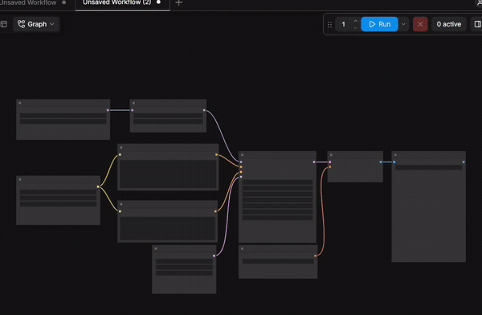
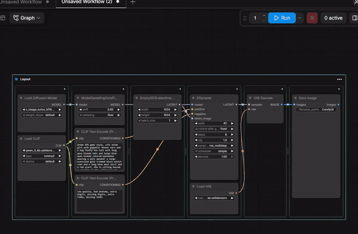
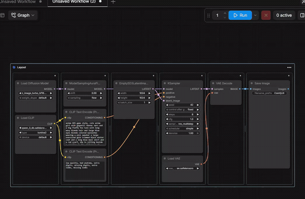
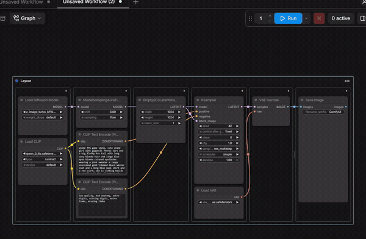

# VF-ComfyUI-Grid-Layout

Reusable grid layout frames for the ComfyUI workflow canvas. Drop normal nodes into a cell to attach them, match their widths, and stack them vertically. Split cells into adjustable columns, rows, or grids.

This is a **frontend extension** installed as a custom-node package. It adds canvas tools — it does not add an executable generation node.

## Try it in 30 seconds

1. Install (below) and refresh ComfyUI with **Ctrl+F5**.
2. Right-click an empty spot on the canvas → **🌀 Add Grid Frame**.
3. Drag any node by its title over a cell and release. The node snaps to the cell's width and the frame grows to fit it.
4. Drop a second node into the same cell to stack it. Click **+** on a cell header to split, grid, or rename.

A ready-made starting point is in **`examples/two-column.grid.json`** (empty template) and **`examples/two-column.workflow.json`** (a runnable layout with Empty Image → Save Image). Open the workflow through ComfyUI's normal **Open** action, or place the template with **right-click canvas → 🌀 Import Grid Template…**.

## Install

### ComfyUI Registry (recommended)

1. In ComfyUI-Manager, open the **Registry** tab.
2. Search for **VF Grid Layout** and click **Install**.
3. Restart ComfyUI and hard-refresh the browser with **Ctrl+F5**.

### Manual install from GitHub

```bash
cd <your-comfyui-path>/custom_nodes
git clone https://github.com/vktrflo/VF-ComfyUI-Grid-Layout.git
```

Restart ComfyUI and hard-refresh the browser with **Ctrl+F5**.

After either install, check that `custom_nodes/VF-ComfyUI-Grid-Layout/__init__.py` and `custom_nodes/VF-ComfyUI-Grid-Layout/web/grid_layout.js` exist directly inside the package folder.

No extra Python packages, frontend build, or model downloads are required.

## VF Link Effects

In **Settings → Lite Graph → Graph**, enable **VF Link Effects** to reveal the
effect selector and **Highlight connected nodes** toggle. **Electricity** sends
bright pulses from output to input; **Neon Glow** gives the wires a steady halo.
Both use the source output port's displayed color and apply to incoming and
outgoing wires of every selected node. Directly connected, unselected nodes get
a quieter border when highlighting is enabled.
Unrelated nodes and links dim to 30% while nodes are selected; selected nodes,
their immediate neighbors, and connected wires remain bright. When ComfyUI's
native **Link Render Mode** is set to **Hidden** and both **VF Link Effects**
and **Highlight connected nodes** are enabled, connected wires and nodes are
shown while all other wires remain hidden. Clearing the selection restores
brightness.

The feature starts enabled with Electricity and remembers your effect and highlighting choices.
Clearing the selection or disabling the feature restores normal rendering.
Electricity remains stationary when your system requests reduced motion.

Run `npm run test:links` against a running ComfyUI to check settings, rendering,
reroutes, both node renderers, and cleanup. Set `COMFYUI_URL` for another server
or `PLAYWRIGHT_MODULE` to an existing Playwright package directory if needed.
The link-effects browser test isolates settings writes from the running user's
preferences and loads this checkout's frontend assets.

### Updating

- **Registry** — update the node from ComfyUI-Manager.
- **Manual** — `git -C custom_nodes/VF-ComfyUI-Grid-Layout pull`

Then restart ComfyUI and use **Ctrl+F5** to clear the old extension from the browser cache.

## Features

- **Frames and cells** — Right-click the canvas to add a grid frame, or wrap an existing selection as **Preserve columns** or **Single stack**. Frames split into columns, rows, and grids up to 16 levels deep, with draggable dividers and edges.
- **Drop to fit** — Drag a node onto a cell by its title and it attaches, snapping to the cell width while the frame grows to fit. Drop several into one cell to stack them; the drop position sets stack order.
- **Inline organization** — Add full-width bottom rows, rename frames and cells inline, move a frame by its header, and transfer or release individual nodes between cells. Frame and row heights auto-fit their content and shrink as content is removed.
- **Header and border styling** — Set the title-bar background, text color (with automatic contrast pick), and font size frame-wide or per cell. Control border color, 1–8 px thickness, and solid, dashed, or dotted style with a live preview.
- **Fill cell height** — Stretch the bottom node of every cell flush with its cell floor; **Undo Fill cell height** releases them again.
- **Lock frame** — Toggle 🔒 / 🔓 in a frame's header to freeze its position and size; menu commands keep working while it is locked.
- **Collapse frame** — Toggle ▴ / ▾ in a frame's header to fold it shut. Its nodes collapse to title bars, stacked flush under the header in reading order with no gaps, and the frame border wraps the whole stack. Dragging a folded frame carries its children along; expanding restores the full layout, except nodes you had already folded yourself, which stay folded.
- **Reusable layouts** — Frame structure is stored in the workflow's `extra.comfyui_grid_layout` metadata (with backward compatibility for `comfyui_layout_templates`), so layouts survive save and reload. Export an empty template to reuse a shape without bringing its nodes along.

## Use

Six short demos, in roughly the order you need them.

### 1. Wrap a messy selection



Select nodes, then right-click the canvas or a selected node → **Create grid layout from selected nodes → Preserve columns** or **Single stack**. The floating toolbar's **Grid** button offers the same two options. Connections and widget values are kept.

### 2. Split cells and add rows


Click **+** on a cell header to split left/right, split top/bottom, create a grid, or rename it. **••• → Add bottom row** appends a full-width cell.

### 3. Style it live



**••• → Change Appearance…** sets the header background, text color, font size, and border color, thickness, and style. Nothing persists until you press **OK**.

### 4. Rename inline


Double-click any frame or cell title, type, then **Enter** or click away to save. **Esc** cancels.

### 5. Resize and shrink to content



Drag dividers or the frame's edges to resize. **••• → Shrink grid to content** fits every cell back to its controls.

### 6. Fill cell height and undo



**••• → Fill cell height** stretches each cell's bottom node flush with its cell. **Ctrl+Z** and **Ctrl+Shift+Z** behave exactly as they do everywhere else in ComfyUI.

### Everything else

- Right-click empty canvas space → **🌀 Add Grid Frame**.
- Drag a node by its title over a cell and release while any part of it overlaps a cell — it attaches even if the node is much taller than a small empty cell. Drop several nodes into the same cell to create a vertical stack; the drop position determines stack order. Newly created nodes placed inside a cell attach automatically too.
- Drag an attached node to another cell to transfer it, or fully clear of every cell to release it. Released nodes keep their current size.
- Click **+** on a cell header to split left/right, split top/bottom, create a grid, or rename the cell. Splitting keeps existing nodes in the first (top or left) cell.
- Drag a vertical divider to change column widths. Each grid cell can be split again. Drag the frame's right or left edge to resize its width; only the cells touching that boundary change width.
- Drag the grid header to move its nodes together. Frame and row heights automatically fit their content and shrink when content is removed. Empty cells retain a small drop area.
- Double-click a frame or cell title to rename it inline. **Enter** or clicking away saves, **Esc** cancels. Empty frame titles keep the previous name; cell titles can be cleared.
- Click **•••** on the frame → **Add bottom row** to append an empty full-width cell. Existing cells keep their heights and attached nodes; the frame extends downward. Split the new row into columns if needed.
- The same **•••** menu can rename the frame, export an empty template, or remove the frame while retaining nodes and connections.
- Click **•••** → **Header configuration…** to set the frame header's background color, text color (leave **Auto (contrast)** checked to keep the automatic dark/light pick), and font size for the frame title bar and all its cell header bars. A cell's **+** menu can override any of the three for that one cell, and the reset entry clears them. The configuration is saved with the workflow and included in exported templates.
- Click **•••** → **Border configuration…** for border color, thickness (1–8 px), and solid/dashed/dotted style with a live preview. Cells inherit the frame's border; a cell's **+** menu can override it.
- Click **•••** → **Change appearance → Reset appearance configuration** to clear all header and border overrides on the frame.
- Click **•••** on a frame → **Fill cell height** to stretch every cell's bottom node flush with its cell (short cells fill up to taller neighbors); **Undo Fill cell height** returns the nodes to their pre-fill heights. A filled frame owns its node heights — manual height drags are overridden while filling is on.
- Click the 🔓 in a frame's header to **lock** it — the icon turns 🔒 and header, edge, and divider drags are ignored; click 🔒 again to unlock. Menu commands still work while locked.
- Click the ▴ in a frame's header to **collapse** it. Its nodes fold down to their title bars, stacked flush under the header in reading order, and the frame border wraps the stack; dragging the folded frame carries them along. Click ▾ to expand and everything returns to its cell. A node you had already folded yourself stays folded. **••• → Collapse grid / Expand grid** does the same thing. Add bottom row is unavailable until the grid is expanded again.
- Select nodes, then right-click the canvas or a selected node → **Create grid layout from selected nodes → Preserve columns** or **Single stack** to wrap your selection in a new frame. The floating selection toolbar's **Grid** button (under **More Options**) offers the same two options.
- Right-click the canvas → **🌀 Import Grid Template…** to place a saved empty layout. Accepts both `.grid.json` and legacy `.layout.json` files.
- Use ComfyUI's normal **Ctrl+Z / Ctrl+Shift+Z** shortcuts for undo/redo.

Node controls are resized through ComfyUI's normal node sizing API. Nodes fill cell widths; their heights retain space for their controls and previews. When a node needs more room, the frame grows instead of clipping it. This can make the frame larger than the requested drag size.

## Saving and reuse

Normal workflow saves include frame positions, sizes, labels, cell splits, and attached node IDs. The extension stores versioned grid layout metadata in `workflow.extra.comfyui_grid_layout` (while transparently reading and migrating older `comfyui_layout_templates` workflow data); node execution, widget values, and connections use ComfyUI's normal workflow data.

Exported templates contain only empty layout structure. Import creates fresh frame and cell IDs and does not create or connect nodes. Workflow copies retain populated layout metadata; copying selected nodes alone does not copy frames.

Frames belong to the currently displayed graph, including subgraphs. Removing this extension leaves the workflow nodes usable; layout metadata remains in saved workflows.

## Troubleshooting

- **The canvas context menu does not show the 🌀 entries.** Hard-refresh the browser (**Ctrl+F5**), confirm the files are in the right place (see the file-location check under **Install**), and restart ComfyUI so it re-scans `custom_nodes`.
- **Layout actions are missing under a heavy extension set.** Some installs with hundreds of other extensions drop extension menu entries; restart ComfyUI with `--disable-all-custom-nodes` and re-check, then re-enable your nodes one block at a time if you need to isolate a conflict.
- **A node looks clipped inside its cell.** The frame should grow instead — if it doesn't, the node's package likely doesn't report its minimum size through ComfyUI's sizing API. File the issue with the upstream node pack, not here.
- **I want to share just the empty layout.** Use **•••** → **Export empty template**. Workflow JSON with all nodes is shared through ComfyUI's normal workflow save.
