# VF Grid Layout for ComfyUI

Organize your ComfyUI canvas with grid frames. Drop nodes into a cell and they snap to its width and stack neatly. Split cells into columns, rows, or grids, and keep the layout with your workflow.

VF Grid Layout adds canvas tools only. It does not add nodes that run during generation, and it does not change your connections or widget values.

## Highlights

### Auto layout

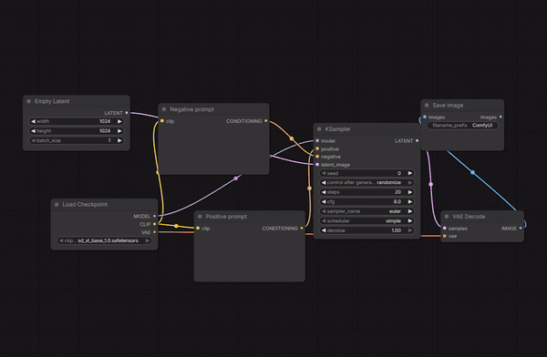

Select your nodes and click **Grid**. Nodes snap into tidy columns, and every connection and widget value stays the same. [More about wrapping a selection](#wrap-a-messy-selection).

### Autohide

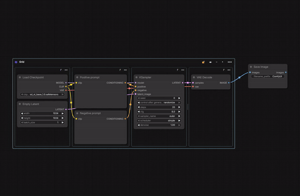

Keep the layout and lose the clutter. The grid hides its frame and bars, comes back while you drag a node over it, and toggles with one click. [More about autohide](#using-autohide).

### Drop previews

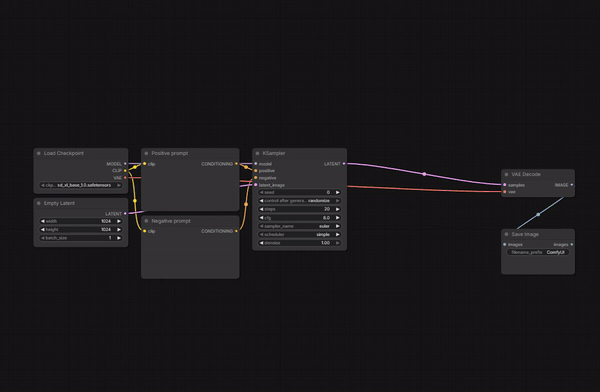

See the result before you let go. A dashed ghost shows whether the node will stack in a cell, start a new column, or start a new row. [More about dropping nodes](#drop-nodes-exactly-where-you-want-them).

## What's new in 1.1 and 1.2

- **[Autohide](#using-autohide)**: New grids hide around your nodes until you need them.
- **[Drop previews](#drop-nodes-exactly-where-you-want-them)**: A ghost shows where a node will land before you let go.
- **[Cell bypass](#bypass-a-cell-or-fill-one-column)**: Bypass or re-enable every node in a cell with one click.
- **[VF Link Effects](#vf-link-effects)**: Animated wires for selected nodes, and a wire reveal for the Hidden link mode.
- **[Look and feel](#style-it-live)**: A tabbed Change Appearance dialog with title bar opacity and a grid background.
- **[Minimize a grid](#minimize-a-grid)**: Shrink a grid to its header. Its wires stay connected through small ports.

## Try it in 30 seconds

1. Install (below), restart ComfyUI, and refresh the browser with **Ctrl+F5**.
2. Right-click an empty spot on the canvas → **🌀 Add Grid Frame**.
3. Drag any node by its title over a cell and release. The node snaps to the cell's width and the frame grows to fit it.
4. Drop a second node into the same cell to stack it. Click **•••** on a cell to split it, make a grid, or rename it.

The package folder also has two examples: `examples/two-column.workflow.json` (a small runnable workflow) and `examples/two-column.grid.json` (an empty layout). Open the workflow with ComfyUI's **Open** action. Place the layout with **right-click canvas → 🌀 Import Grid Template…**.

## Install

### ComfyUI Registry (recommended)

1. In ComfyUI-Manager, open the **Registry** tab.
2. Search for **VF Grid Layout** and click **Install**.
3. Restart ComfyUI and refresh the browser with **Ctrl+F5**.

### Manual install

```bash
cd <your-comfyui-path>/custom_nodes
git clone https://github.com/vktrflo/VF-ComfyUI-Grid-Layout.git
```

Restart ComfyUI and refresh the browser with **Ctrl+F5**. No extra Python packages or model downloads are needed.

### Updating

- **Registry**: update the node from ComfyUI-Manager.
- **Manual**: run `git pull` inside `custom_nodes/VF-ComfyUI-Grid-Layout`.

Then restart ComfyUI and refresh with **Ctrl+F5** so the browser loads the new version.

## Features

- **Frames and cells**: Add a grid frame from the canvas menu, or wrap selected nodes in one. Split cells into columns, rows, and grids, with draggable dividers and edges.
- **Autohide**: Grids hide their frame and cell bars until you need them, so the canvas stays clean. Toggle it from the selection toolbox or the frame header.
- **Drop previews**: While you drag, a dashed ghost shows where the node will land: in a cell, beside a cell as a new column, or below the grid as a new full-width row.
- **Drop to fit**: Drag a node onto a cell and it attaches, snaps to the cell width, and the frame grows to fit. Drop several nodes into one cell to stack them.
- **Bypass a cell**: Bypass or re-enable all nodes in a cell with one click.
- **VF Link Effects**: Animated or glowing wires for selected nodes, with dimming for everything unrelated.
- **Appearance**: Set the title bar color, text color, font size, and opacity, the border style, and a grid background color or image. Apply them to the whole frame or to one cell.
- **Lock, collapse, and minimize**: Freeze a frame in place, fold its nodes to their title bars, or shrink it to just its header.
- **Fill cell height**: Stretch the bottom node in every cell down to the cell floor, so columns line up.
- **Saved with your workflow**: Layouts save and load with the workflow. Export an empty layout to reuse its shape in other workflows.

## Use

### Wrap a messy selection

Select nodes, then click **Grid** in the floating selection toolbox. You can also right-click the canvas or a selected node → **Create grid layout from selected nodes**. Nodes that sit above each other become one column. Connections and widget values are kept. New grids start with [autohide](#using-autohide) on, so click the **eye** button in the toolbox to show the frame.

### Using autohide

New grids start with autohide on. A grid with autohide on hides its frame, cell bars, and background, and shows only your nodes. Empty grids stay visible until you drop a node in.

- The grid appears while you drag a node over it, so you can still see where it will land.
- To turn autohide off or on, select a node in the grid and click the **eye** button next to **Grid** in the selection toolbox. You can also click 👁 / 🙈 in the frame header.
- With autohide on, cells don't reserve space for a title bar, so nodes don't move when you select them. Cell buttons show as a small pill in the corner of each cell.

### Drop nodes exactly where you want them

While you drag a node over a grid, a dashed ghost shows the result before you let go:

- **Inside a cell, or above a node**: the node joins that cell.
- **Just below a node**: the node stacks below it in the same cell.
- **Near the left or right edge of a cell**: a new column is added on that side.
- **A little below the grid**: a new full-width row is added at the bottom.

To take a node out of a grid, drag it fully clear of every cell. It keeps its current size.

### Bypass a cell or fill one column

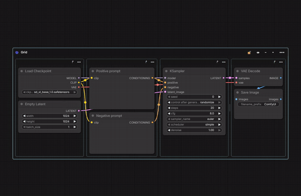

Click **↱** on a cell to bypass all nodes in that cell. Click it again to re-enable them. To fill a single column, click **•••** on a cell → **Fill cell height (this column)**. Other columns keep their heights.

### VF Link Effects

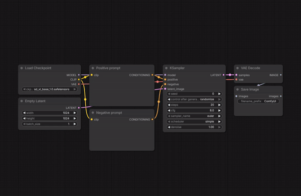

In **Settings → Lite Graph → Graph**, turn on **VF Link Effects** to choose an effect:

- **Electricity** sends bright pulses along the wires from output to input.
- **Neon Glow** gives the wires a steady halo.

Effects apply to the wires of every selected node and use the color of the output port. While nodes are selected, unrelated nodes and wires dim. Turn on **Highlight connected nodes** to give directly connected nodes a soft border.

If ComfyUI's **Link Render Mode** is set to **Hidden**, selecting a node still shows its connected wires while all other wires stay hidden. Clearing the selection restores normal rendering. Electricity stays still when your system asks for reduced motion.

### Style it live

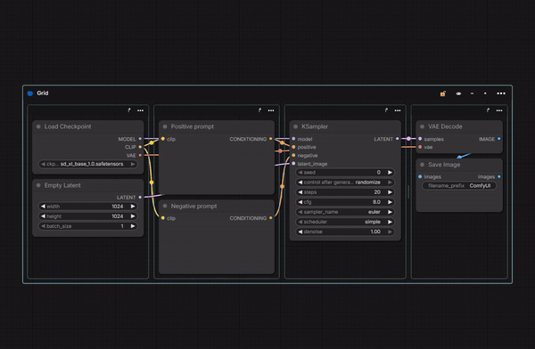

**••• → Change Appearance…** opens tabs for **Title Bar**, **Border**, and **Grid Background**. Set **Title bar opacity** on the first tab to fade the title bars instead of hiding them. Changes preview live, and nothing is saved until you press **OK**. A cell's **•••** menu can override the frame's look for that one cell.

### Rename inline

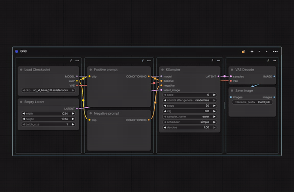

Double-click any frame or cell title, type, then press **Enter** or click away to save. **Esc** cancels.

### Split cells and add rows

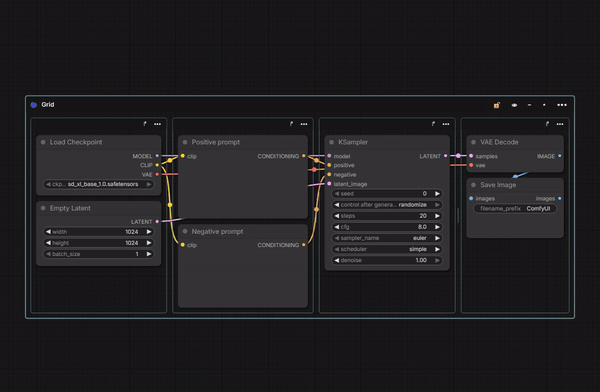

Click **•••** on a cell to split it left/right or top/bottom, create a grid, or rename it. Click **•••** on the frame header → **Add bottom row** to add a full-width row.

### Resize and shrink to content

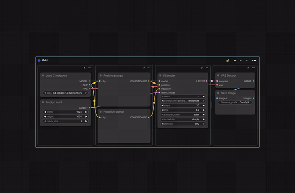

Drag dividers or the frame's left or right edge to resize. Only the cells that touch that edge change width. **••• → Shrink grid to content** fits every cell back to its nodes.

### Fill cell height and undo

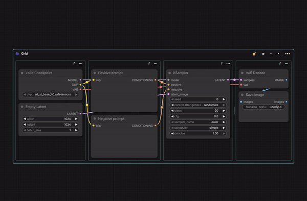

**••• → Fill cell height (all columns)** stretches each cell's bottom node to the cell floor. **Undo Fill cell height (all columns)** returns the nodes to their own heights. **Ctrl+Z** and **Ctrl+Shift+Z** work as they do everywhere else in ComfyUI.

### Minimize a grid

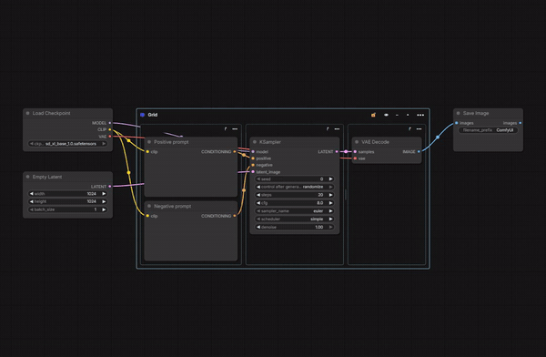

Click **−** on the frame header to shrink the frame to its header and hide its nodes. Wires to the hidden nodes connect to one input port and one output port on the header. Hover a port to list its wires. Click **◻** to restore the grid.

### Frame header buttons

- **🔒 / 🔓 Lock**: Freezes the frame's position and size. Menu commands still work.
- **👁 / 🙈 Autohide**: Shows or hides the grid around your nodes.
- **− Minimize**: Shrinks the frame to its header and hides its nodes. Wires to the hidden nodes connect to small ports on the header.
- **▴ / ▾ Collapse**: Folds every node to its title bar, stacked under the header. Expand to restore the layout.
- **•••**: Frame menu with appearance, fill, shrink, add bottom row, export, and remove.

### More tips

- Newly created nodes that you place inside a cell attach automatically.
- Drag an attached node to another cell to move it there.
- Drag the frame header to move the frame and all its nodes together.
- Frame and row heights fit their content and shrink when you remove nodes. Empty cells keep a small drop area.
- **↱** on a cell bypasses all nodes in that cell. Click it again to re-enable them.
- **••• → Remove grid (keep nodes)** removes the frame and leaves your nodes and connections in place.
- If a node needs more room than its cell, the frame grows instead of clipping the node.

## Saving and sharing

- Saving a workflow saves its grids: positions, sizes, titles, splits, styles, and which nodes are in which cell.
- **••• → Export empty template** saves just the layout shape, with no nodes. Place it in any workflow with **right-click canvas → 🌀 Import Grid Template…**.
- Grids belong to the graph you are viewing, including subgraphs.
- If you uninstall VF Grid Layout, your workflows still open and run. Only the grid frames are gone.

## Troubleshooting

- **The 🌀 entries are missing from the canvas menu.** Refresh the browser with **Ctrl+F5**, then restart ComfyUI. With a manual install, make sure the folder is `custom_nodes/VF-ComfyUI-Grid-Layout` and not nested one level deeper.
- **Grid menu entries are missing with many other extensions installed.** Very large extension sets can crowd out menu entries. Disable other custom nodes in groups to find the conflict.
- **A node looks clipped inside its cell.** The frame normally grows to fit. If it doesn't, that node pack may not report its size to ComfyUI. Please report it to the node pack's author.
- **I want to share only the layout.** Use **••• → Export empty template**. To share nodes too, save the workflow as usual.
